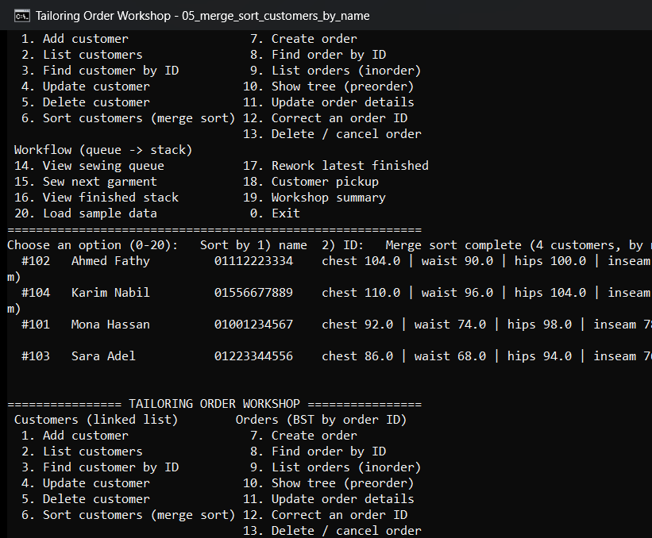
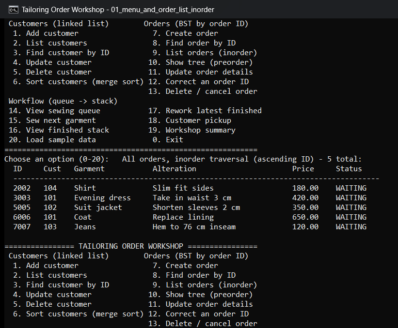
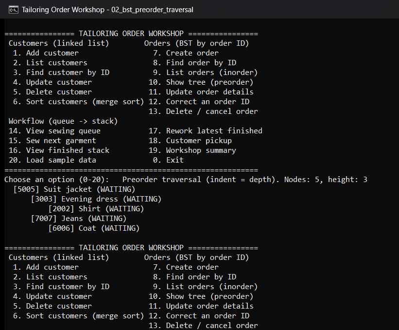
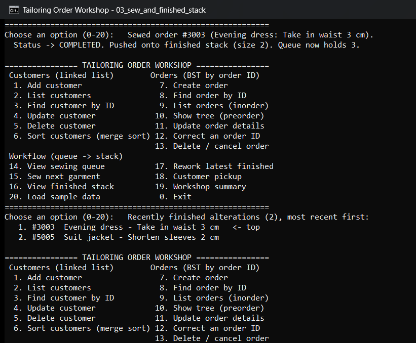
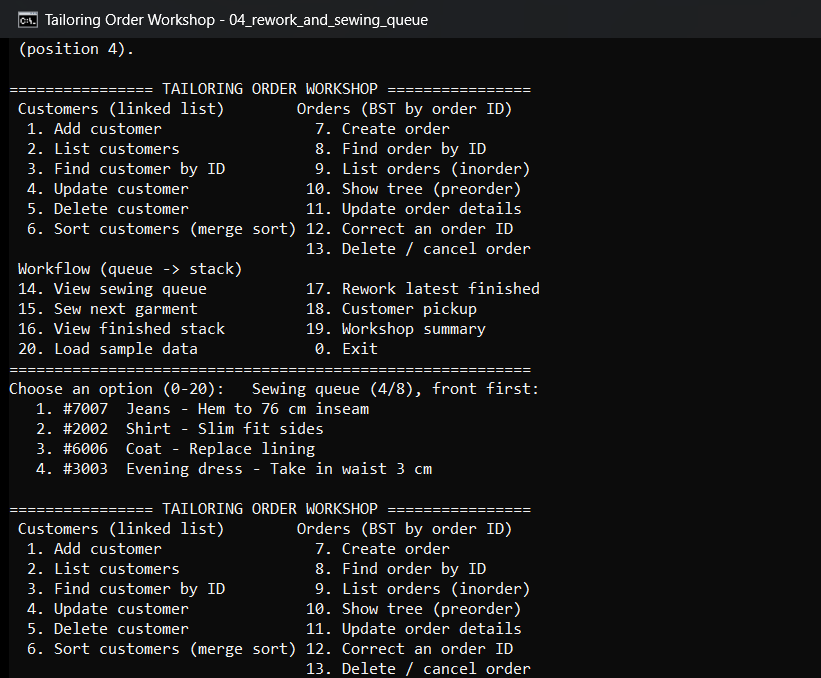
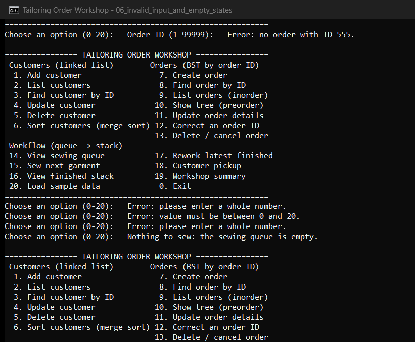
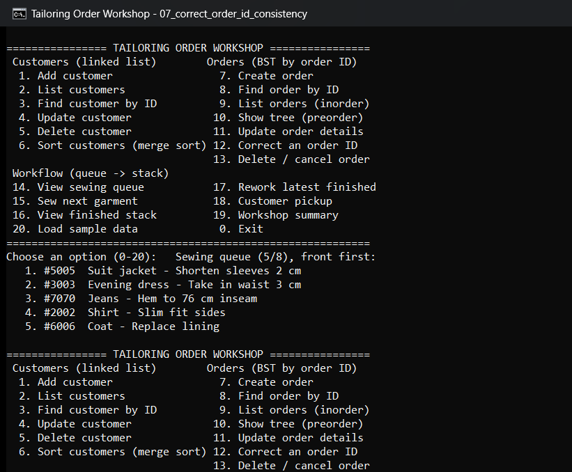
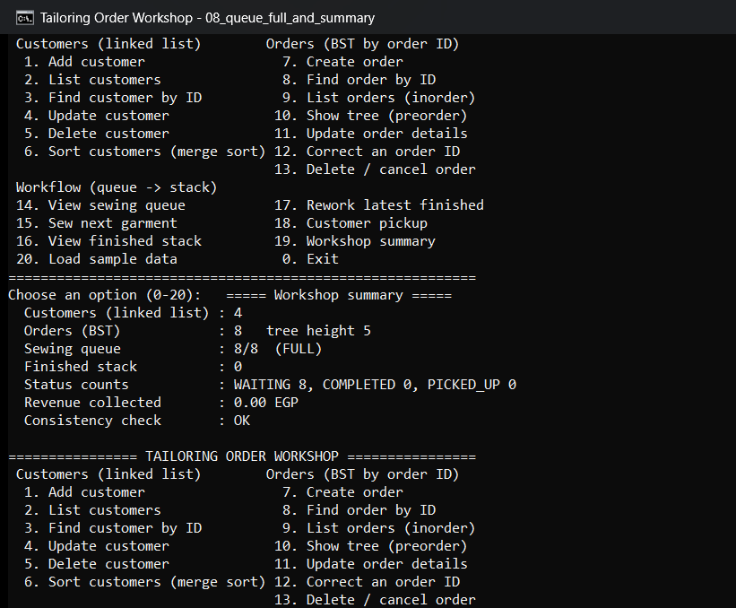
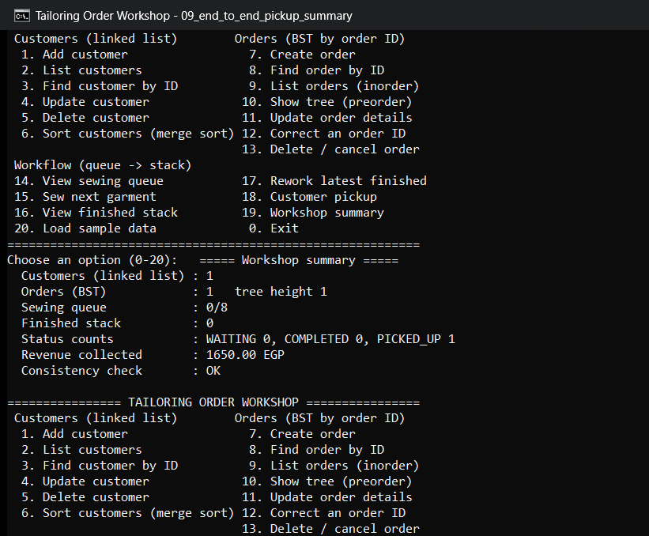

# Project Report: Tailoring Order Workshop

**Course:** CS212 Data Structures, Fall 2026-2027
**Project:** 94, Tailoring Order Workshop
**Language:** C++17. No STL containers are used; every data structure is implemented by hand.

---

## 1. Problem description

A tailoring workshop receives garments that need alterations. Each order belongs to a customer whose body measurements are kept on file. Garments wait on a rack until a tailor is free and are sewn in arrival order. Finished garments then wait for pickup, and quality control may send the most recently finished one back for rework. Staff must also be able to look up any order instantly by its ID.

The program supports this workflow through a menu-driven console application. It provides full CRUD for customers and orders, validates every input, and keeps all data structures consistent with each other.

## 2. Architecture overview

```
                 +------------------------------+
                 |   main.cpp (menu + input)    |
                 +---------------+--------------+
                                 | calls
                 +---------------v--------------+
                 |  Workshop (coordinator)      |  keeps invariants I1-I5
                 +--+---------+--------+-----+--+
                    |         |        |     |
     CustomerList   |  OrderBST         |     |  Stack<int>
     (linked list)  |  (BST, by ID)  Queue<int> (finished, LIFO)
     customers +    |  full Order   (sewing rack,
     measurements   |  records       FIFO, cap 8)
```

| Structure | File | Operations | Role |
|---|---|---|---|
| **Linked list** | `CustomerList.h/.cpp` | insert, delete, search, traverse, merge sort | Customer records with chest, waist, hips, inseam and sleeve measurements |
| **BST** | `OrderBST.h/.cpp` | insert, delete, search, inorder, preorder, height | Order lookup by unique ID. Holds the **only** copy of each order's details. |
| **Queue** | `Queue.h` (circular array) | enqueue, dequeue, front, isEmpty, isFull, size | Garments awaiting sewing. The capacity of 8 models the physical rack. |
| **Stack** | `Stack.h` (linked nodes) | push, pop, peek, isEmpty, size | Recently finished alterations. The newest is on top for quality-control rework. |

### How the structures work together
The queue and the stack store only **order IDs**. All order details live in the BST, so data is never duplicated. When an order is edited, every view of it shows the change immediately. As an order moves through the workshop, its ID moves between the structures and its `status` field changes:

```
createOrder        sewNext            pickUp
 BST insert  --->  dequeue  ------->  removed from stack
 + enqueue         + push             status PICKED_UP
 WAITING           COMPLETED  <--+
                     |           | reworkLatest: pop, then enqueue again
                     +-----------+ (status goes back to WAITING)
```

### Consistency invariants
Menu option 19 checks these invariants live:

- **I1:** Every order is in the BST exactly once.
- **I2:** Status `WAITING` ⇔ the order's ID is in the queue.
- **I3:** Status `COMPLETED` ⇔ the order's ID is on the stack.
- **I4:** A `PICKED_UP` order is in neither the queue nor the stack.
- **I5:** Every order's customer exists in the linked list.

### Duplicate-ID policy
Customer IDs and order IDs must be unique.

- An insert with an existing ID is **rejected** with an error message, and the existing record stays unchanged.
- Correcting an order ID to one that is already in use is rejected the same way.

### Assumptions
- All data is held in memory and is not saved to a file.
- IDs are integers from 1 to 99999, entered by staff.
- Measurements are in cm and must fall within realistic ranges. Prices are in EGP, from 0 to 100000.
- The rack (queue) holds 8 garments. The finished stack has no fixed limit.
- One tailor sews one garment at a time.
- Picked-up orders stay in the BST as history and cannot be edited.

## 3. Scenarios beyond basic CRUD

1. **Process an order through the workshop.** Option 15 dequeues the next garment, marks it `COMPLETED` and pushes it onto the finished stack. Option 18 is the customer pickup: it removes the order from the stack and marks it `PICKED_UP`.
2. **Quality-control rework (LIFO).** Option 17 pops the most recently finished garment and sends it back into the sewing queue. It is refused, with nothing changed, if the queue is full.
3. **Correct a wrong order ID.** Option 12 deletes the BST node and re-inserts it under the new key. It then rewrites the ID **in place** in the queue (by rotating with dequeue and enqueue) or in the stack (through a temporary stack), so the order keeps its position.
4. **Safe deletion.** Deleting an order removes it from the BST and from whichever of the queue or stack holds it. A customer cannot be deleted while any order still references them.

## 4. Algorithm: merge sort on the customer linked list

- **Where:** Menu option 6 sorts customers by name or by ID.
- **Why it fits:** The customers are in a singly linked list, which has no random access. Merge sort only needs sequential access: it splits the list with slow and fast pointers and merges by relinking nodes. No array copy is needed. Quicksort and heap sort, by contrast, depend on indexing. Merge sort is also **stable**, so customers with equal names keep their order, with customer ID used as a tie-breaker.
- **Time complexity:** O(n log n) in the best, average and worst cases.
- **Space complexity:** O(log n), for the recursion only.
- **Representative output:**

```
Sort by 1) name  2) ID:   Merge sort complete (4 customers, by name):
  #102   Ahmed Fathy         01112223334    chest 104.0 | waist 90.0 | ...
  #104   Karim Nabil         01556677889    chest 110.0 | waist 96.0 | ...
  #101   Mona Hassan         01001234567    chest 92.0 | waist 74.0 | ...
  #103   Sara Adel           01223344556    chest 86.0 | waist 68.0 | ...
```



## 5. Big-O summary

`n` is the number of items and `h` is the BST height: log n on average, n in the worst case.

| Operation | Complexity |
|---|---|
| Stack push / pop / peek / isEmpty / size | O(1) |
| Queue enqueue / dequeue / front / isEmpty / size | O(1) |
| Linked list insert (with duplicate check) / delete / search / traverse | O(n) |
| Merge sort of the customer list | O(n log n) |
| BST insert / delete / search | O(h) |
| BST inorder / preorder traversal | O(n) |
| Create order (customer lookup + BST insert + enqueue) | O(c + h) |
| Sew next / rework latest | O(h) |
| Pickup / delete / correct ID (removing from the queue or stack) | O(h + q) or O(h + s) |

Here c is the number of customers, q the queue size and s the stack size.

## 6. Testing

The full test plan is in [Tests/TEST_PLAN.md](../Tests/TEST_PLAN.md). Each test script and its captured output are in `Tests/`. All test cases passed. They cover:

- **Normal operations:** CRUD on customers and orders, the sewing workflow, and pickup.
- **Empty structures:** every view and action on an empty system.
- **Single-item cases:** deleting a root-only BST and deleting the only node in the linked list.
- **Boundaries:** deleting the first and last list nodes, deleting a BST root with two children, and a full queue.
- **Invalid input:** letters, out-of-range values, empty fields, missing IDs, duplicate IDs, and end of input.
- **End-to-end trace:** one order goes from creation through sewing, rework, a second sewing, an edit and pickup.

### Screenshots

| Feature | Screenshot |
|---|---|
| Menu and inorder listing of orders (BST) |  |
| Preorder traversal showing the BST shape |  |
| Sewing, then the finished stack |  |
| Rework (pop, then enqueue again) and the sewing queue |  |
| Invalid input and empty-state messages |  |
| Correcting an order ID while the queue position is kept |  |
| Full queue rejection and the workshop summary |  |
| End of the end-to-end trace: pickup and summary |  |

The screenshots come from runs where the menu choices were fed from an input file, so the typed values themselves are not echoed on screen.

## 7. Design limitation

**The BST is not self-balancing.** Order IDs are usually handed out in increasing order (8001, 8002, 8003, …). Inserted in that order, the tree degenerates toward a linked list, and search, insert and delete fall from O(log n) to O(n). The test run shows this: after orders 8001 to 8004 were added, the tree held 8 nodes but had height 5. An AVL or red-black tree would keep the height at O(log n).

A second, smaller limitation: removing an order from the middle of the queue or the stack (on cancel or pickup) costs O(size), because those ADTs only expose operations at their ends.
